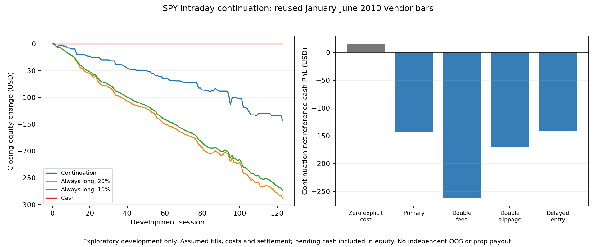

# Intraday Continuation

A fixed SPY intraday continuation rule lost **$143.42 over 60 trades** in January-June 2010 after assumed costs. With zero explicit fees or slippage it made $15.65; cent rounding still applied. Every nonzero-cost stress lost money. The rule failed its registered development screen and was retired.

The idea was simple: positive movement during the first 30 minutes might persist into late-session trading as information and portfolio demand arrive gradually. This version went long at 15:31 and exited at 15:59 after a positive 09:30-to-09:59 move. It deliberately omitted the overnight component used by the published intraday-momentum model, so it is an exploratory extension, not a replication.



[Read the report](REPORT.md) for costs, controls and uncertainty. [The protocol](PROTOCOL.md) records the rules fixed before evaluation. [The audit notes](AUDIT.md) distinguish tests of code from checks of saved results.

## Reproduce the checks

With Python and the packages in requirements.txt installed:

```text
python -m unittest discover -p "test_*.py" -v
python verify_snapshot.py
python plot_results.py
```

These commands run fabricated test cases, check the saved cash summaries and redraw the figure. They do not download data, rerun the historical strategy or regenerate its bootstrap. The pure model and parser are included for inspection. Licensed vendor bars are excluded, so independent raw-data replication is not possible from this repository alone.

## What the result means

This was reused-data development, with assumed fills, trading costs and a ten-calendar-day cash-settlement rule. It was not independent out-of-sample validation. No real execution, intraday prop-firm breach path or payout was established. The fixed lower-exposure comparator lost more partly because it paid commissions on more days. Relative improvement over a losing control is not a profitable strategy; cash did better.

The result rejects this fixed policy under its stated assumptions. It does not rule out all momentum strategies. No threshold, date, size or regime filter was changed to rescue it.
