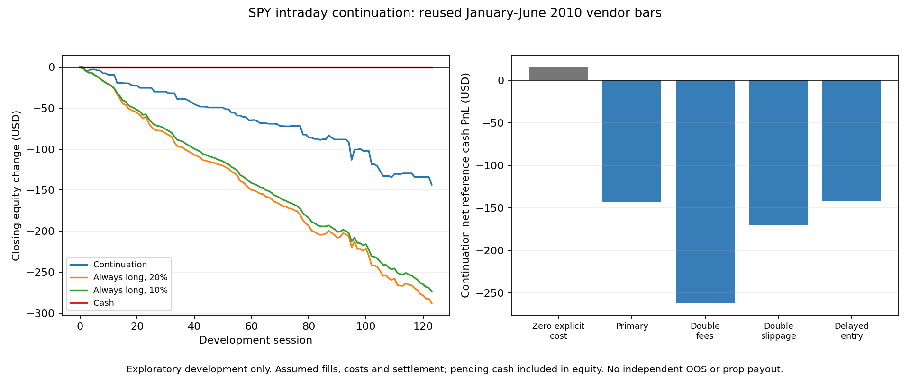

Public disclosure copy. Original private provenance is summarized in AUDIT.md; raw inputs and private bindings are omitted.

# Intraday continuation failed after assumed trading costs

The fixed SPY continuation policy lost **$143.42** over 60 trades in the registered January-June 2010 development window. Starting equity was $10,000. The zero-explicit-cost case made only $15.65, with cent rounding still applied. Every nonzero-cost stress lost money. The policy fails the preregistered screen and will not advance to confirmation.

This is a conditional vendor-bar reference study. It does not establish achievable fills, a real-market upper bound, a prop-firm payout advantage or a rejection of every intraday momentum strategy. No parameters were selected from the result.

## What was tested

A strictly positive move from the 09:30 open to the 09:59 close triggered a long entry at the 15:31 minute open and exit at the 15:59 minute open. Quantity was fixed at 10:00 from 20% of settled cash and the observed 09:59 close. Each control had its own account. Sale proceeds were unavailable for ten calendar days, followed by the next planned session; this is a conservative assumption, not certified historical clearing. The strategy held no shares overnight.

The policy is distinct from E17's opening reversal, but uses the same previously acquired six-month SPY file. The literature motivating it includes overnight movement and overlaps 2010; this same-day-only extension omits that component. Neither reused data nor published findings supply independent confirmation. Details are in the mechanism review (see AUDIT.md).

## Cash results

| Scenario | Continuation trades | Continuation net | Always long, 20% | Always long, 10% | Cash |
|---|---:|---:|---:|---:|---:|
| Zero explicit fees/slippage | 60 | $15.65 | $16.12 | $10.65 | $0.00 |
| Primary | 60 | $-143.42 | $-287.77 | $-273.34 | $0.00 |
| Double commissions | 60 | $-261.82 | $-531.99 | $-518.29 | $0.00 |
| Double slippage | 60 | $-170.25 | $-326.50 | $-298.84 | $0.00 |
| Delayed entry | 60 | $-141.77 | $-292.09 | $-276.15 | $0.00 |

Primary costs were 2 basis points adverse slippage on each side and a per-fill commission of the larger of $1 or $0.005 per share. Purchases rounded up to cents and sales down. Fees and slippage are assumptions, not verified 2010 broker rates. Double-fee, double-slippage and one-minute entry-delay stresses used the same fixed signal and exit rule. Zero explicit cost is not a raw frictionless fill because cent rounding remains.

The primary account had 10 profitable trades and 50 losing trades; 63 sessions stayed flat. There were no zero-quantity or insufficient-cash skips. Total commissions were $120.00. Final closing equity was $9,856.58, comprising $6,784.46 settled cash and $3,072.12 pending proceeds. Pending proceeds are not immediately spendable or withdrawable cash. Daily closing-equity maximum drawdown was $143.42; this does not measure intraday rule breaches.

## Uncertainty and the failed decision

The fixed circular moving-block bootstrap used 5,000 paired resamples, five-session blocks and PCG64 seed 2026103104. It resampled daily cash changes, including zero days; it did not rerun cash eligibility or estimate account-survival paths. The primary daily mean was -$1.1660, with the 5th and 95th bootstrap percentiles at -$1.5780 and -$0.7854. Those percentiles describe uncertainty conditional on this reused vendor sample and model, not independent OOS performance or a multiple-testing-adjusted discovery.

Continuation exceeded the fixed 10% always-long control by $129.92, with a positive lower bootstrap percentile for the daily difference. That does not make it profitable: cash earned zero, while both trading accounts lost money. The continuation account paid $126.00 less in commissions because it traded fewer days. The fixed 10% control is not exactly matched realized exposure, and this comparison cannot establish timing alpha.

Two of the four required conditions failed: primary net PnL was negative and all three nonzero-cost stress PnLs were negative. The 30-trade minimum and positive lower excess percentile passed, but could not replace the failed conditions. Retire this fixed exploratory policy without changing its sign, dates, size, entry/exit interval or adding a retrospective regime filter.

## Provenance and checks

Protocol and supplemental family allocation were committed at e0e2d10 before late-session numerical parsing. The independently reviewed implementation was committed at 58cb811 before the sole claimed evaluation. The first shell invocation failed to import a module from the repository root, before a claim or source read existed. The same reviewed code was then invoked from the LAB directory and completed once. No claim was reset and no market evaluation was repeated.

The source SHA256 matched the registered file. The parser scanned 88,007 rows, excluded 80,627 before financial conversion and validated 7,380 required minute rows across all 123 sessions. Native units, source clock accuracy, exchange lineage and executable quotes remain unqualified. The parser's returns_computed=false flag describes its quality stage only; the subsequent cash engine did calculate this study's returns.

All 54 small controls passed parent and independent review. A separate scalar calculation reconciled 160 fabricated cash cases. The once-only runner retained source/code/protocol bindings and a permanent claim. The figure reads saved results only and was visually checked. Independent saved-result review checks the stored cash paths and report; any limits on independently recomputing bootstrap percentiles are retained there.

The original lab retained its prior negative findings and all protected confirmation periods. No independent out-of-sample sample was opened. There is no verified edge.

Evidence: protocol (see AUDIT.md), saved result (see AUDIT.md), receipt (see AUDIT.md), implementation review (see AUDIT.md). Raw source data and trade-level source prices are not published.
